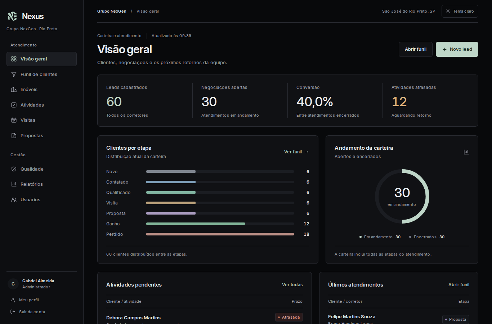

# Nexus — CRM imobiliário

**Java 17 · Spring Boot 3.5.7 · Thymeleaf · Microsoft SQL Server**

Projeto acadêmico da Fatec São José do Rio Preto, curso de Informática para
Negócios — 2026.2. Organiza clientes, imóveis, atividades, visitas, propostas,
usuários e indicadores do estudo de caso do Grupo NexGen.

## Comece aqui

**Para testar sem compilar:** abra a área **Releases** deste repositório e
baixe **Nexus_Publico_Executavel.zip**, nos Assets. Ele já inclui o JAR
corrigido, o código, os scripts e a documentação, sem credenciais reais.

**Para estudar ou alterar o código:** use os fontes deste repositório e
compile com JDK 17 e Maven. O ZIP de fontes automático do GitHub não traz o JAR.
A raiz é a pasta que contém este README, `dist`, `database` e os iniciadores.

| Sua situação | Próximo passo |
|---|---|
| PC sem os programas | Siga o [guia Windows com HeidiSQL](docs/Instalacao_Windows_HeidiSQL.md), desde a etapa 1 |
| Java e SQL Server instalados, mas sem banco Nexus | Configure o acesso e instale o banco pelas etapas 3 a 5 do guia |
| Banco Nexus já funcionando | Use o pacote executável da Release, feche o Java antigo, preserve suas configurações locais e execute `iniciar-sqlserver.bat` |
| Baixou somente os fontes públicos | Compile com `recompilar.bat` ou obtenha o JAR da Release e salve em `dist/nexus.jar` |

A versão pública mantém dados fictícios de demonstração. Ela não distribui
o banco do autor, senhas pessoais nem configuração de e-mail preenchida.
O login `admin@example.test` é criado apenas na carga ou em uma base vazia.

Os cadastros ficam no SQL Server. Trocar a pasta do aplicativo não apaga os dados.
Uma base existente mantém os usuários e as senhas que já foram alterados.

## O que instalar

| Programa | Download oficial | Finalidade |
|---|---|---|
| Temurin JDK 17 | [Windows x64, MSI](https://adoptium.net/temurin/releases/?version=17&os=windows&arch=x64&package=jdk) | Executar o Java |
| SQL Server 2022 Express | [Instalador Microsoft](https://www.microsoft.com/en-us/download/details.aspx?id=108838) | Armazenar os dados |
| HeidiSQL | [Windows x64 Installer](https://www.heidisql.com/download.php) | Conectar e executar os scripts |

Para executar um JAR pronto, SSMS, Maven, Node.js e Python são dispensáveis.
Para construir os fontes deste repositório, instale JDK 17 e Maven e execute
`recompilar.bat` (Windows) ou `bash recompilar.sh` (Linux/macOS).
A primeira configuração do SQL Server é necessária uma vez em cada PC novo.

## Caminho da primeira execução

1. Instale os três programas e confirme `java -version` em um Prompt novo.
2. No SQL Server Configuration Manager, habilite **TCP/IP** em **Protocolos para SQLEXPRESS**, sem usar a seção “32 bits”. Em **IPAll**, deixe **Portas TCP Dinâmicas vazio** e **Porta TCP = 1433**. Reinicie **SQL Server (SQLEXPRESS)**.
3. Se ainda não definiu o `sa`, entre no HeidiSQL com **autenticação do Windows** e siga a etapa 4 do guia. O arquivo `database/heidisql/Configurar_Acesso_SQL_Server.sql` permite definir sua senha com proteção contra o uso do texto de exemplo.
4. Entre no HeidiSQL por **Microsoft SQL Server (TCP/IP)**, IP **127.0.0.1**, porta **1433**, usuário **sa** e sua senha; desmarque a autenticação do Windows.
5. Em uma aba **Consulta**, carregue [Instalar_Nexus_HeidiSQL.sql](database/heidisql/Instalar_Nexus_HeidiSQL.sql), ative **Parar em erros** e execute o arquivo inteiro com **F9**, em UTF-8.
6. A carga nova deve terminar com **3 usuários, 60 atendimentos e 20 imóveis** no banco **NexoImob**. O instalador inclui os scripts 01 a 06: execute apenas esse caminho.
7. Abra **iniciar-sqlserver.bat**, informe a senha do banco e aguarde `Started NexoImobApplication`.
8. Acesse **[http://localhost:8080/login](http://localhost:8080/login)**. Mantenha a janela Java aberta; use **Ctrl+C** para encerrar.

O [guia detalhado](docs/Instalacao_Windows_HeidiSQL.md) mostra cada configuração,
inclusive a instalação básica que não pede senha do `sa`. Não repita o
instalador inicial sobre uma base que já contém o Nexus.

## Acessos de demonstração

| Perfil | E-mail | Senha do site |
|---|---|---|
| Administrador | `admin@example.test` | `NexoDemo2026!` |
| Corretor | `ana@example.test` | `NexoDemo2026!` |
| Corretor | `bruno@example.test` | `NexoDemo2026!` |

As contas vêm da carga inicial. O administrador aprova novos corretores.
A **senha do banco `sa`**, a **senha do site** e a **senha de app do Gmail**
servem a acessos diferentes. O iniciador pede a senha do banco.

Por padrão, a conexão usa `localhost:1433`, banco `NexoImob` e usuário `sa`.
O arquivo `configurar-sqlserver.local.bat` é opcional, para mudar a conexão.
O exemplo deixa a senha para ser digitada na inicialização.

## Recuperação por e-mail — configuração opcional

**Esta versão pública vem sem credenciais reais.** Os logins, cadastros e
demais telas podem ser usados sem SMTP. Somente o envio de recuperação exige
uma conta remetente configurada. Não é necessário programar para preenchê-la.

1. Na raiz do projeto, faça uma cópia de `smtp.exemplo.properties` e renomeie para **smtp.local.properties**.
2. No Explorador de Arquivos, ative a exibição de extensões. Confira que o nome termina em `.properties`, sem `.txt` depois.
3. Abra a cópia com o **Bloco de Notas**.
4. Substitua `SEU_EMAIL@gmail.com` nas linhas **spring.mail.username** e **app.mail-from** pelo e-mail da conta remetente.
5. Ative a verificação em duas etapas nessa conta Google, abra [Senhas de app](https://myaccount.google.com/apppasswords) e gere uma senha para o Nexus.
6. Na linha **spring.mail.password**, substitua `COLE_A_SENHA_DE_APP` pelos 16 caracteres gerados, sem os espaços de separação. Use a senha de app, não a senha normal do Gmail.
7. Salve o arquivo e reinicie o Nexus. Mantenha servidor `smtp.gmail.com`, porta `587`, autenticação e STARTTLS como estão no exemplo.

Preencha somente os valores depois de `=`, sem acrescentar aspas.

O administrador de demonstração usa **admin@example.test**, um endereço
fictício que não recebe mensagens. Para testar a recuperação, entre com esse
administrador, abra **Usuários → Novo usuário**, cadastre um e-mail real,
escolha o perfil, marque **Acesso ativo** e defina uma senha com pelo menos
10 caracteres. Saia e use **Esqueci minha senha** com o e-mail desse cadastro.
O e-mail destinatário pode ser diferente da conta configurada como remetente.

O envio funciona localmente com internet. Confira também o spam e abra o link
no PC que executa o Nexus: `localhost` se refere ao computador de quem abre o
link. O token vale por 15 minutos.

**Não publique smtp.local.properties.** O `.gitignore` já exclui esse arquivo,
as configurações locais do banco e arquivos de ambiente. O e-mail sozinho não
abre uma conta Gmail; a senha de app deve permanecer privada.

## Se algo der errado

| Sintoma | O que conferir |
|---|---|
| `java` não é reconhecido | Instale o JDK com PATH e abra um Prompt novo |
| Erro de versão Java | Use Java 17 ou superior compatível |
| Falha TCP, porta ou tempo esgotado | Serviço SQLEXPRESS iniciado, TCP/IP habilitado, IPAll em 1433 e reinício aplicado |
| `Login failed for user sa` | Senha, `sa` habilitado, modo misto e reinício; entre pelo Windows para corrigir o acesso |
| Banco `NexoImob` não encontrado ou tabela ausente | Confira se a instalação terminou na mesma instância usada pelo Java |
| Erro SQL 11736 em uma instalação antiga | Use [Concluir_Instalacao_Nexus_HeidiSQL.sql](database/heidisql/Concluir_Instalacao_Nexus_HeidiSQL.sql), somente se a estrutura existe e os dados estão vazios |
| Mensagem “base já contém o projeto” | Não reinstale; confira o banco existente e siga para iniciar o Java |
| Tela “Please sign in”, zero repositórios ou templates ausentes | O JAR antigo continua em uso; feche o Java anterior e use o executável corrigido da Release, ou recompile os fontes |
| Porta 8080 ocupada | Feche a outra execução do Nexus com Ctrl+C e inicie uma única janela |
| Login do site recusado | Use a senha do site, confira o e-mail, a carga inicial e se a conta está ativa |
| Recuperação não chega | Confira usuário ativo, spam, credencial SMTP, internet e os erros na janela Java |

## Conferência e documentação

- [Verificar_Nexus_HeidiSQL.sql](database/heidisql/Verificar_Nexus_HeidiSQL.sql): confere a estrutura e a consistência básica.
- [Testar_Fluxos_Nexus_HeidiSQL.sql](database/heidisql/Testar_Fluxos_Nexus_HeidiSQL.sql): quatro cenários de procedures e triggers em base de avaliação, com reversão dos registros.
- [Guia do código](docs/Guia_do_Codigo.md), [dicionário](docs/Dicionario_de_Dados.md) e [roteiro de apresentação](docs/Roteiro_Demonstracao.md).
- Relatório em [PDF](documentacao/Relatorio_Nexus.pdf) e [Word](documentacao/Relatorio_Nexus.docx); [planilha estatística](documentacao/Nexus_Estatistica.xlsx).

O back-end usa controladores, serviços, repositórios JPA e JDBC; as operações
de etapa, visita e aceite utilizam procedures. Há dez tabelas, três procedures,
três views, três triggers e três funções. O banco é exclusivamente SQL Server;
o Java valida o esquema existente e não cria tabelas automaticamente.

O executável passou em **5 verificações de empacotamento**, **34 verificações
isoladas** e um teste HTTP com repositórios substitutos. Persistência, consultas,
transações no SQL Server e entrega real pelo Gmail precisam de conferência no
ambiente de apresentação. O [registro da revisão](docs/Correcao_Executavel.md)
informa o escopo; [verificacao/README.md](verificacao/README.md) explica como repetir
as verificações opcionais. Para recompilar os fontes, use JDK 17 e Maven com
`recompilar.bat` ou `bash recompilar.sh`.

## Publicação e download

O [passo a passo para publicar no GitHub](docs/Publicar_no_GitHub.md) mostra
como enviar os fontes pelo GitHub Desktop e anexar o pacote público executável
em uma Release. Publique somente os pacotes públicos, sem arquivos locais.

## Equipe

Kevin Emanuel Barbim de Castilho · Davi Mancini Ortolan · João Marcio da Silva
Longhi · José Otavio Vasconcelos Braga · Leonardo dos Santos Ferreira.

Fatec São José do Rio Preto · Informática para Negócios · 4º semestre · 2026.2.
