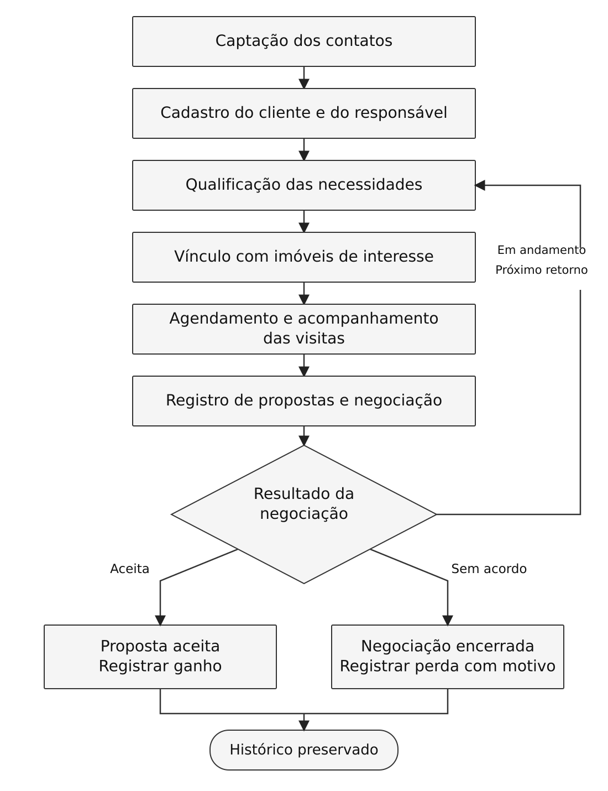

# Apêndice C Mapeamento do processo comercial

O fluxo representa o processo comercial adotado no estudo de caso, com captação, cadastro, qualificação, interesses, visitas, propostas e negociação.

O desenho editável está em Fluxograma_Processo.svg. As etapas do funil no sistema são Novo, Contatado, Qualificado, Visita, Proposta, Ganho e Perdido. Cada imóvel representa uma unidade negociável.

Visitas e propostas exigem interesse vinculado. Visita virtual registra zero km. Ganho exige proposta aceita, perda exige motivo e atendimentos encerrados preservam o histórico.

Fonte: elaboração própria, com base no fluxo implementado no Nexus (2026).
