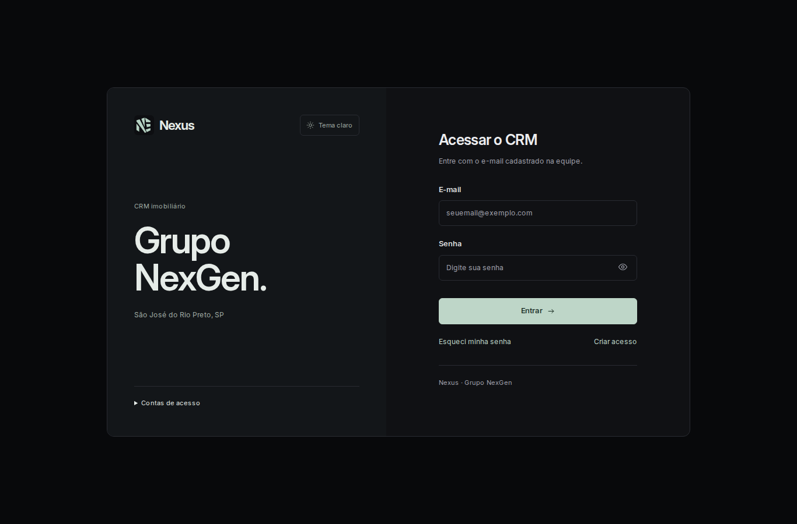
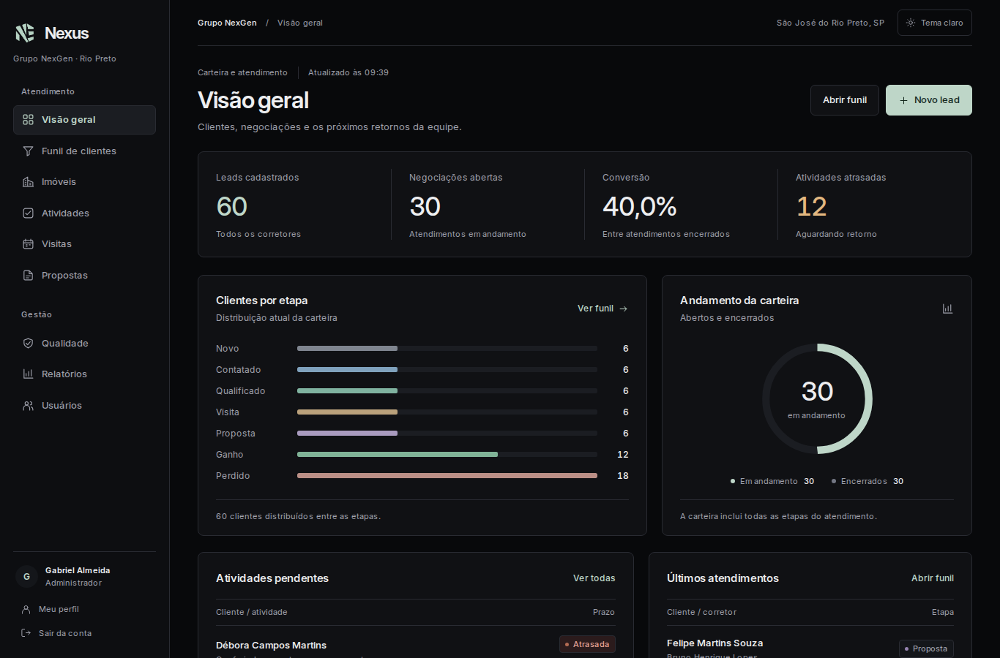
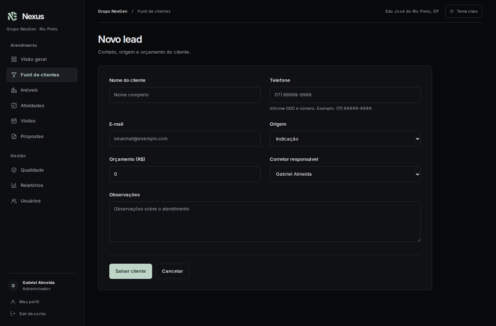
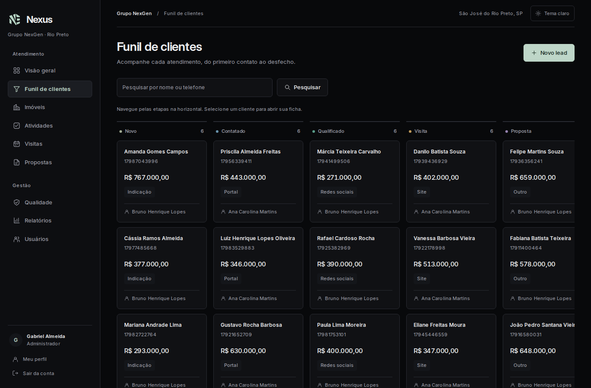
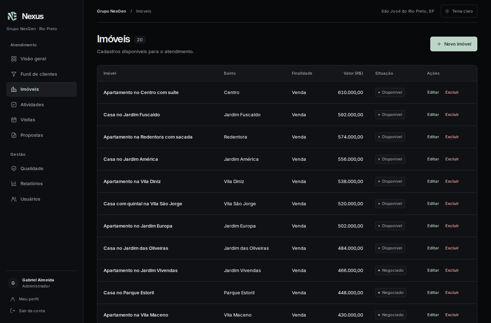
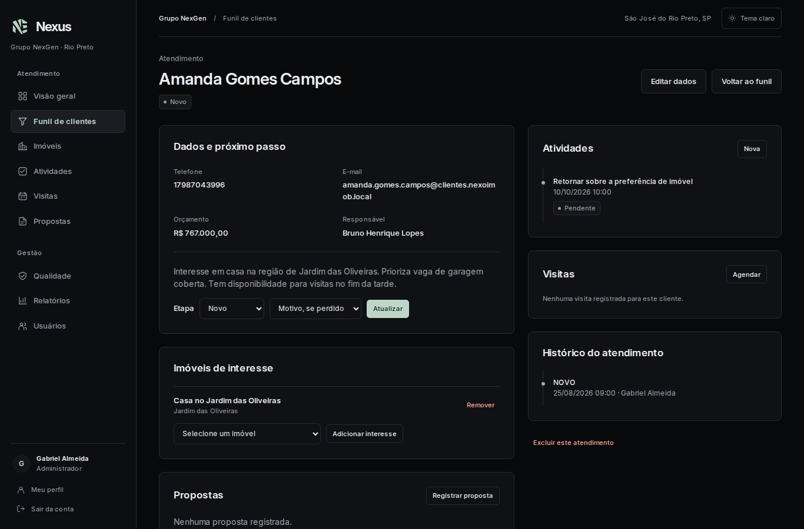

# Anexo C Demonstração do Nexus

As seis imagens são capturas reais da interface incluídas no projeto recebido. Mostram funcionalidades de uma edição anterior da interface; não documentam o uso pela empresa nem comprovam execução em SQL Server. A edição atual deve ser demonstrada novamente com o banco SQL Server.

## Login e acesso ao Nexus

## Dashboard e indicadores da carteira

## Cadastro de clientes e responsável pelo atendimento

## Funil comercial com as etapas dos clientes

## Consulta dos imóveis disponíveis e negociados

## Ficha do cliente com atividades, visitas e área de propostas

Fonte: Nexus, capturas da aplicação fornecidas no pacote (2026).
